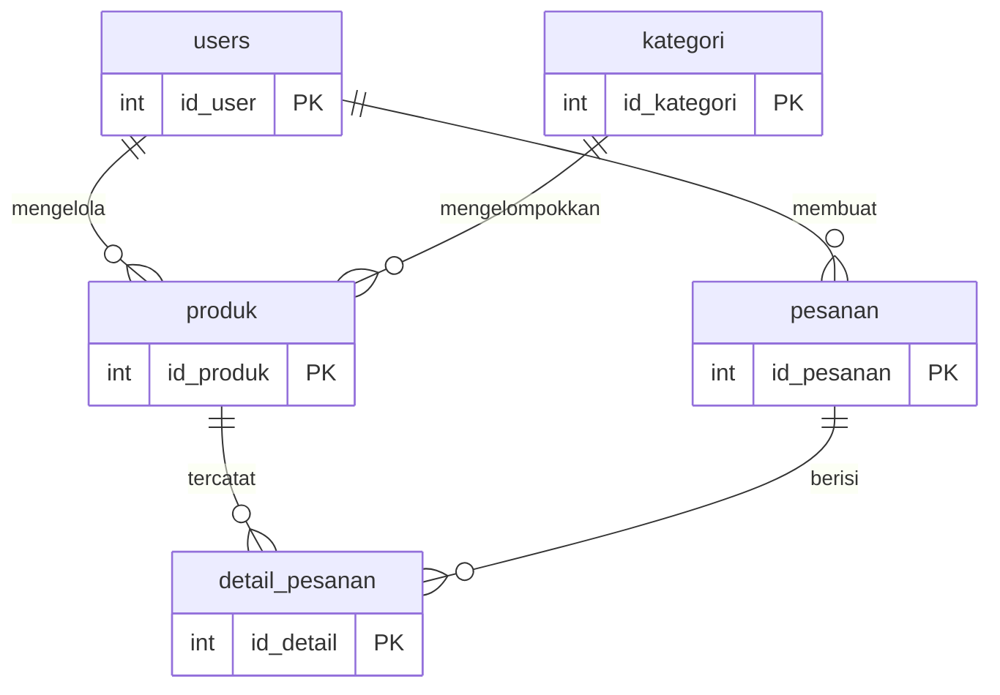
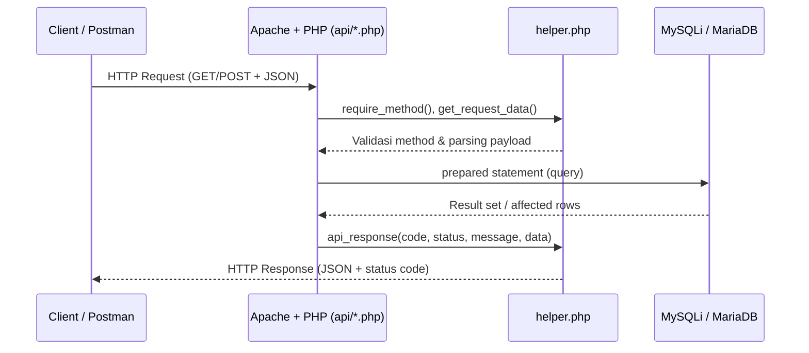

# DOKUMEN RANCANGAN ENDPOINT API

> **Proyek:** BangkokFarm — Web Marketplace & Web Service REST API
> **Soal:** 12 (Pengembangan Web Service / REST API Marketplace)
> **Teknologi:** PHP Native, MySQLi (prepared statement), JSON, Apache (XAMPP)
> **Versi API:** 1.0.0

---

## 1. Ringkasan

REST API BangkokFarm adalah layanan web (*web service*) berbasis **HTTP + JSON** yang menyediakan
akses data katalog produk ayam/ternak dan pemrosesan transaksi pemesanan. API ini dirancang agar
dapat dikonsumsi oleh aplikasi lain (aplikasi mobile, POS, atau sistem mitra) secara terpisah dari
antarmuka web.

| Item | Keterangan |
| :--- | :--- |
| Nama layanan | BangkokFarm Marketplace REST API |
| Gaya arsitektur | RESTful (resource-based, stateless, JSON) |
| Format pertukaran data | `application/json; charset=UTF-8` |
| Base URL (lokal) | `http://localhost/web_penjualanAyam/api` |
| Autentikasi | Belum diterapkan pada versi 1.0.0 (endpoint publik / read-mostly) |
| CORS | Diizinkan (`Access-Control-Allow-Origin: *`) + preflight `OPTIONS` |
| Penanganan parameter | Query string (GET) dan JSON body (POST) |

---

## 2. Arsitektur Sistem

```text
┌──────────────────┐        HTTP Request (JSON)         ┌───────────────────────────┐
│  Client / Postman │ ─────────────────────────────────► │  Apache (XAMPP)           │
│  Aplikasi Mobile  │                                     │  + PHP 8.2 Native         │
│  Aplikasi Pihak 3 │ ◄───────────────────────────────── │  REST API (/api/*.php)    │
└──────────────────┘        HTTP Response (JSON)        └─────────────┬─────────────┘
                                                                      │ MySQLi (prepared stmt)
                                                                      ▼
                                                        ┌───────────────────────────┐
                                                        │  MariaDB 10.4  (XAMPP)    │
                                                        │  db_marketplace_ayam      │
                                                        └───────────────────────────┘
```

Komponen kode:

| Berkas | Peran |
| :--- | :--- |
| `api/helper.php` | Helper bersama: envelope JSON, header CORS, HTTP status, validasi method, parser body, formatter URL gambar. |
| `api/index.php` | Endpoint dokumentasi/overview API (self-describing). |
| `api/produk.php` | Resource **produk** (list, filter, cari, urut, pagination, detail). |
| `api/kategori.php` | Resource **kategori** (list beserta jumlah produk, detail). |
| `api/pesanan.php` | Resource **pesanan** (POST checkout, GET riwayat/detail). |
| `config/koneksi.php` | Konfigurasi koneksi database MySQLi. |

---

## 3. Konvensi Umum

### 3.1 Format Response (Envelope)

Setiap response menggunakan struktur seragam:

```json
{
  "status": "success | error",
  "code": 200,
  "message": "Pesan deskriptif",
  "data": { },
  "total": 12,
  "limit": 50,
  "offset": 0
}
```

- `status` — hasil ringkas (`success` / `error`).
- `code` — HTTP status code yang dikirim.
- `message` — keterangan human-readable.
- `data` — payload utama (objek array maupun objek tunggal; `null` bila error).
- `total`, `limit`, `offset` — metadata tambahan (hanya pada endpoint list/pagination).

### 3.2 Pemetaan Method HTTP

| Method | Fungsi | Idempoten |
| :--- | :--- | :--- |
| `GET` | Membaca resource | Ya |
| `POST` | Membuat resource baru (pesanan) | Tidak |
| `OPTIONS` | Preflight CORS | Ya |

Method selain yang diizinkan pada suatu endpoint menghasilkan **`405 Method Not Allowed`**.

### 3.3 Penamaan Field

- Field utama memakai `snake_case`, mengikuti nama kolom database.
- Ditambahkan field turunan untuk kenyamanan klien: `harga_formatted`, `subtotal_format`,
  `total_formatted`, `gambar_url`, `nama_penjual`, `nama_kategori`.

---

## 4. Daftar Endpoint (Ringkas)

| No | Method | Endpoint | Fungsi | Sukses |
| :-: | :--- | :--- | :--- | :--- |
| 1 | `GET` | `/api/index.php` | Dokumentasi / overview API | `200 OK` |
| 2 | `GET` | `/api/produk.php` | Daftar produk (filter, cari, urut, pagination) | `200 OK` |
| 3 | `GET` | `/api/produk.php?id={id}` | Detail satu produk | `200 OK` |
| 4 | `GET` | `/api/kategori.php` | Daftar kategori + jumlah produk | `200 OK` |
| 5 | `GET` | `/api/kategori.php?id={id}` | Detail satu kategori | `200 OK` |
| 6 | `POST` | `/api/pesanan.php` | Membuat pesanan (checkout) | `201 Created` |
| 7 | `GET` | `/api/pesanan.php` | Daftar riwayat pesanan | `200 OK` |
| 8 | `GET` | `/api/pesanan.php?id={id}` | Detail pesanan + rincian item | `200 OK` |

---

## 5. Rancangan Detail Endpoint

### 5.1 `GET /api/produk.php` — Daftar Produk

**Deskripsi:** mengambil daftar produk (ayam bangkok, trah import, ternak, bibit DOC, pakan/jamu).

**Query Parameters (opsional):**

| Parameter | Tipe | Default | Keterangan |
| :--- | :--- | :--- | :--- |
| `kategori` | integer | - | Filter berdasarkan `id_kategori` |
| `cari` / `q` | string | - | Cari pada `nama_produk` dan `deskripsi` (LIKE) |
| `urutkan` | enum | `terbaru` | `terbaru` \| `harga_asc` \| `harga_desc` \| `stok_desc` |
| `limit` | integer | `50` | Jumlah data (1–100) |
| `offset` | integer | `0` | Offset pagination |

**Contoh request:** `GET /api/produk.php?kategori=1&urutkan=harga_asc`

**Response `200 OK` (ringkas):**

```json
{
  "status": "success",
  "code": 200,
  "message": "Daftar produk berhasil diambil.",
  "total": 2,
  "limit": 50,
  "offset": 0,
  "data": [
    {
      "id_produk": 2,
      "id_kategori": 1,
      "nama_kategori": "Ayam Bangkok & Aduan",
      "id_penjual": 1,
      "nama_penjual": "Administrator Farm",
      "nama_produk": "Ayam Bangkok Wangkas Emas Super",
      "harga": 1650000,
      "harga_formatted": "Rp 1.650.000",
      "stok": 4,
      "gambar_url": "http://localhost/web_penjualanAyam/assets/img/produk/bangkok_wangkas.jpg"
    }
  ]
}
```

---

### 5.2 `GET /api/produk.php?id={id}` — Detail Produk

**Deskripsi:** mengambil satu produk berdasarkan primary key `id_produk`.

**Parameter:** `id` (integer, wajib).

**Response `200 OK` (ringkas):**

```json
{
  "status": "success",
  "code": 200,
  "message": "Detail produk berhasil ditemukan.",
  "data": {
    "id_produk": 1,
    "id_kategori": 1,
    "nama_kategori": "Ayam Bangkok & Aduan",
    "id_penjual": 1,
    "nama_penjual": "Administrator Farm",
    "telepon_penjual": "081288997766",
    "nama_produk": "Ayam Bangkok Super Wiring Kuning (Pejantan F1)",
    "harga": 1850000,
    "harga_formatted": "Rp 1.850.000",
    "stok": 5,
    "gambar_url": "http://localhost/web_penjualanAyam/assets/img/produk/bangkok_wiring_kuning.jpg"
  }
}
```

**Error:**

- `400 Bad Request` — `id` bukan integer positif.
- `404 Not Found` — ID tidak ditemukan.

---

### 5.3 `GET /api/kategori.php` — Daftar Kategori

**Deskripsi:** mengambil seluruh kategori beserta jumlah produk tiap kategori (`LEFT JOIN` + `COUNT`).

**Response `200 OK`:**

```json
{
  "status": "success",
  "code": 200,
  "message": "Daftar kategori berhasil diambil.",
  "total": 5,
  "data": [
    { "id_kategori": 1, "nama_kategori": "Ayam Bangkok & Aduan", "total_produk": 2 },
    { "id_kategori": 2, "nama_kategori": "Ayam Trah Import (Pakhoy, Birma, Shamo)", "total_produk": 3 }
  ]
}
```

---

### 5.4 `GET /api/kategori.php?id={id}` — Detail Kategori

**Parameter:** `id` (integer, wajib).

**Response `200 OK`:**

```json
{
  "status": "success",
  "code": 200,
  "message": "Detail kategori berhasil ditemukan.",
  "data": { "id_kategori": 1, "nama_kategori": "Ayam Bangkok & Aduan", "total_produk": 2 }
}
```

**Error:** `400 Bad Request` (id tidak valid), `404 Not Found` (tidak ada).

---

### 5.5 `POST /api/pesanan.php` — Buat Pesanan (Checkout)

**Deskripsi:** membuat transaksi pesanan baru. Sistem memvalidasi stok, menghitung subtotal,
menyimpan header `pesanan` + baris `detail_pesanan`, dan mengurangi stok produk secara
**atomik** (`begin_transaction` → `commit`/`rollback`).

**Headers:** `Content-Type: application/json`

**Body (JSON):**

```json
{
  "id_user": 2,
  "nama_penerima": "Budi Peternak",
  "telepon": "081299887711",
  "alamat_kirim": "Jl. Kenangan No. 10, Bandung (Ambil via KIB)",
  "items": [
    { "id_produk": 1, "qty": 1 },
    { "id_produk": 10, "qty": 2 }
  ]
}
```

**Aturan validasi:**

| Field | Aturan |
| :--- | :--- |
| `nama_penerima` | Wajib, tidak boleh kosong |
| `telepon` | Wajib |
| `alamat_kirim` | Wajib |
| `items` | Wajib array, minimal 1 item, tiap item wajib `id_produk` dan `qty >= 1` |
| stok | `qty` tidak boleh melebihi `produk.stok` |
| `id_user` | Opsional; bila kosong/invalid → fallback ke user pertama berperan `user` |

**Response `201 Created` (ringkas):**

```json
{
  "status": "success",
  "code": 201,
  "message": "Pesanan berhasil dibuat.",
  "data": {
    "id_pesanan": 1,
    "id_pembeli": 2,
    "nama_penerima": "Budi Peternak",
    "status": "pending",
    "total": 2020000,
    "total_formatted": "Rp 2.020.000",
    "tanggal": "2026-11-19 20:54:10",
    "total_item": 2,
    "items": [
      {
        "id_produk": 1,
        "nama_produk": "Ayam Bangkok Super Wiring Kuning (Pejantan F1)",
        "harga_satuan": 1850000,
        "qty": 1,
        "subtotal": 1850000,
        "subtotal_format": "Rp 1.850.000"
      }
    ]
  }
}
```

**Error:** `400 Bad Request` (validasi gagal / stok tidak cukup), `404 Not Found` (produk/user tidak ada), `500 Internal Server Error` (gagal transaksi).

---

### 5.6 `GET /api/pesanan.php` — Daftar Riwayat Pesanan

**Query Parameters:** `id_user` (opsional) untuk menyaring pesanan milik user tertentu.

**Response `200 OK`:**

```json
{
  "status": "success",
  "code": 200,
  "message": "Daftar riwayat pesanan berhasil diambil.",
  "total": 1,
  "data": [
    {
      "id_pesanan": 1,
      "id_pembeli": 2,
      "tanggal": "2026-11-19 20:54:10",
      "total": 2020000,
      "total_formatted": "Rp 2.020.000",
      "status": "pending",
      "nama_penerima": "Budi Peternak",
      "nama_pembeli": "Budi Peternak"
    }
  ]
}
```

---

### 5.7 `GET /api/pesanan.php?id={id}` — Detail Pesanan

Menampilkan satu transaksi beserta seluruh baris `detail_pesanan` (item produk, qty, subtotal).

**Response `200 OK` (ringkas):**

```json
{
  "status": "success",
  "code": 200,
  "message": "Detail pesanan ditemukan.",
  "data": {
    "id_pesanan": 1,
    "id_pembeli": 2,
    "nama_pembeli": "Budi Peternak",
    "email_pembeli": "user@ayammart.test",
    "total": 2020000,
    "total_formatted": "Rp 2.020.000",
    "status": "pending",
    "items": [
      {
        "id_detail": 1,
        "id_produk": 1,
        "nama_produk": "Ayam Bangkok Super Wiring Kuning (Pejantan F1)",
        "qty": 1,
        "harga_satuan": 1850000,
        "subtotal": 1850000,
        "subtotal_format": "Rp 1.850.000"
      }
    ]
  }
}
```

---

## 6. Pemetaan HTTP Status Code

| Status Code | Makna | Kondisi penerapan |
| :--- | :--- | :--- |
| `200 OK` | Sukses | GET berhasil (list/detail produk, kategori, pesanan). |
| `201 Created` | Berhasil dibuat | POST pesanan sukses disimpan. |
| `400 Bad Request` | Permintaan tidak valid | Field wajib kosong, qty ≤ 0, JSON rusak, stok kurang. |
| `404 Not Found` | Tidak ditemukan | `id` produk/kategori/pesanan tidak ada. |
| `405 Method Not Allowed` | Method dilarang | Method HTTP tidak sesuai (mis. POST ke endpoint GET). |
| `500 Internal Server Error` | Kesalahan server | Kegagalan query atau kegagalan transaksi database. |

---

## 7. Sumber Data (Relasi Tabel)



| Endpoint | Tabel/sumber utama |
| :--- | :--- |
| `/api/produk.php` | `produk` JOIN `kategori` JOIN `users` |
| `/api/kategori.php` | `kategori` LEFT JOIN `produk` |
| `/api/pesanan.php` (POST) | `pesanan`, `detail_pesanan`, `produk` (update stok) |
| `/api/pesanan.php` (GET) | `pesanan` JOIN `users`, JOIN `detail_pesanan` + `produk` |

---

## 8. Alur Request (Sequence)



---

## 9. Rancangan Keamanan

| Aspek | Penerapan |
| :--- | :--- |
| SQL Injection | Semua query memakai **prepared statement** (`bind_param`). |
| Validasi input | `filter_var()`, `trim()`, serta pengecekan tipe & rentang nilai. |
| Konsistensi data | **Transaksi atomik** (`begin_transaction`/`commit`/`rollback`) saat checkout. |
| CORS | Header `Access-Control-Allow-Origin`, `Allow-Methods`, `Allow-Headers`. |
| Metode HTTP | Dibatasi sesuai endpoint via `require_method()`. |

> Catatan: versi 1.0.0 belum menerapkan **autentikasi token (API key/JWT)** dan **rate limiting**;
> direkomendasikan untuk pengembangan lanjutan pada versi berikutnya.
